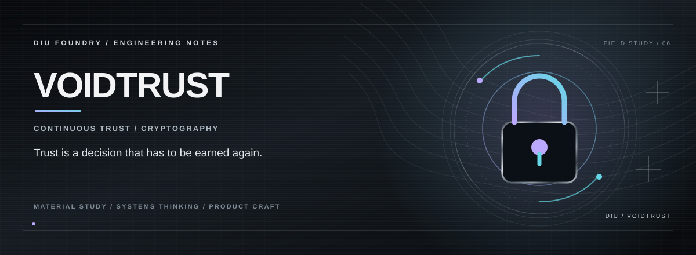

# VOIDTRUST

> **CONTINUOUS TRUST / CRYPTOGRAPHY.**

## THE PREMISE

VoidTrust explores a connected-device security model where trust is continuously evaluated instead of granted once during onboarding.

## THE EXPERIENCE

**Identity starts the session.**  
**Verification protects each request.**  
**Trust can move from allow to restrict to lockdown.**

## THE SYSTEM

The architecture is organized around device identity, authenticated requests, verification and replay protection, followed by a dynamic trust decision and operator-facing response.

## THE STACK

Web control plane · cryptographic request verification · trust-state enforcement · responsive security UI

## RUN

Requirements: Node.js and npm.

```bash
npm ci
npm run dev
```

Vite prints the local development URL. Run these checks before deployment:

```bash
npm run build
npm run lint
npm test
```

This is a security-architecture prototype, not a substitute for verified server-side authorization or cryptographic review.

## PROJECT STATE

**Zero-trust architecture prototype**

The repository documents the capabilities that are actually implemented; future integrations are intentionally separated from the current product surface.

---

<p align="center"><strong>K. KISHOR KUMAR</strong><br><sub>ENGINEERING / PRODUCT / SYSTEMS</sub></p>
